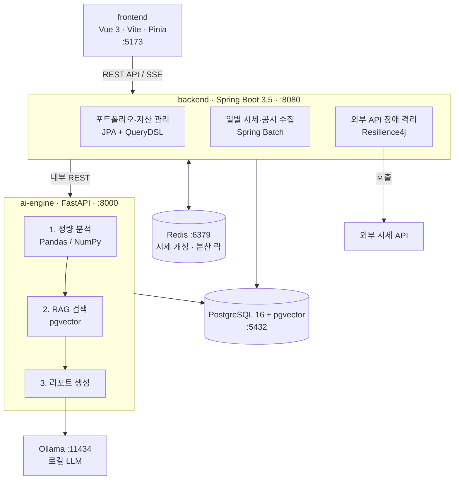
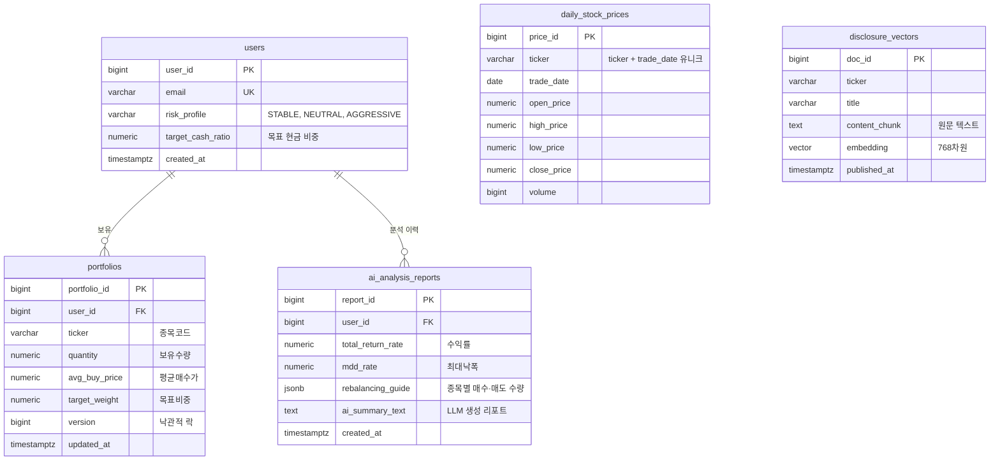

  

<h1 align="center">FinGuard AI</h1>

  망분리 환경을 가정한 로컬 AI 기반 주식 포트폴리오 분석 및 리밸런싱 플랫폼

  
  
  
  
  
  
  

## 무엇을 만드는가

보유 종목과 자산 데이터를 외부로 내보내지 않고, 로컬 환경 안에서 시세 수집부터 AI 리포트 생성까지 처리하는 백엔드 파이프라인입니다.

- **데이터는 밖으로 나가지 않습니다.** 상용 LLM API 대신 로컬 Ollama 모델을 사용합니다.
- **계산은 코드가, 설명은 LLM이 합니다.** 수익률, MDD, 리밸런싱 수량은 Python으로 계산하고, LLM은 계산된 수치와 검색된 공시 원문만 받아 리포트를 작성합니다.
- **비용 0원으로 동작합니다.** 모든 구성 요소가 로컬과 Docker에서 실행됩니다.

## 아키텍처

## ERD

`daily_stock_prices`와 `disclosure_vectors`는 외래 키 없이 `ticker` 값으로 연결된다.

## 저장소

| 저장소 | 역할 | 스택 |
| :--- | :--- | :--- |
| backend | 포트폴리오 관리, 시세 수집 배치, 외부 API 장애 격리 | Java 17, Spring Boot, JPA, QueryDSL, Spring Batch, Resilience4j |
| ai-engine | 정량 지표 계산, 공시 RAG 검색, 리포트 생성 | Python 3.11, FastAPI, Pandas, NumPy, pgvector |
| frontend | 대시보드, 분석 진행 상태 스트리밍 화면 | Vue 3, Vite, Pinia |
| infra | 로컬 실행 환경과 DB 스키마 | Docker Compose, PostgreSQL, Redis |
| docs | 아키텍처 설계서, 트러블슈팅과 성능 측정 기록 | Markdown |

## 진행 상황

- [x] 인프라와 서비스별 초기 프로젝트 세팅
- [ ] 포트폴리오 관리와 일별 시세 수집 배치
- [ ] 정량 분석과 RAG 기반 리포트 생성
- [ ] 장애 격리, 캐싱, 부하 테스트
